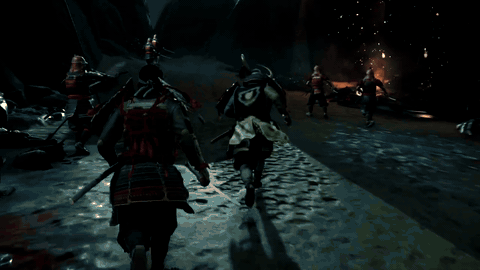

# ghostldr

Runs PS4 game backups and homebrew inside *Star Wars Racer Revenge* (SWRR, PS4 US CUSA03474 or EU CUSA03492) on a PS5. It goes through [Luac0re](https://github.com/Gezine/Luac0re)'s userland JIT exploit, with no kernel exploit and no jailbreak.

**Ghost of Tsushima (CUSA11456 v2.18) is the only title tested so far.** The loader itself is title-agnostic: what Ghost needs beyond the defaults is in its profile. Another title boots as far as its imports and memory needs allow; [docs/compatibility.md](docs/compatibility.md) is how to bring one up.

[](docs/media/ghostldr-demo.mp4?raw=true)

[Full demo, 3½ minutes (MP4)](docs/media/ghostldr-demo.mp4?raw=true): Luac0re's loader, the ghostldr send, then Ghost booting from the save containers into gameplay on a stock 13.60 PS5.

The game's files live in SWRR's own save containers, installed once over the network ("ghostfs"). Several titles can be installed side by side.

**US and EU SWRR both work.** The two regions run the same executable, so the same core and offsets serve both. Each region keeps its own saved data, though: install the game data from the SWRR you will play it in (an install made in US SWRR doesn't appear in EU SWRR, and vice versa).

**No game files are included.** Bring your own dumps; Ghost's CUSA11456 dump goes in `build/ghost/app0`, which git ignores.

Start with [docs/ghost-on-stock-ps5.md](docs/ghost-on-stock-ps5.md): triggering Luac0re, the data install, and booting. Other titles: [docs/compatibility.md](docs/compatibility.md). Container names and the title catalogue: [docs/ghostfs-catalogue.md](docs/ghostfs-catalogue.md).

## Layout

| Path | What it is |
|---|---|
| `ghostldr/native/` | **The loader core** (C, about 6,400 lines). Runs inside SWRR from Luac0re's JIT buffer. Its runtime extension (`ext/`, see [ext/README.md](ghostldr/native/ext/README.md)) carries the NID table and more HLE code, and is fetched from the computer at boot. |
| `ghostldr/host/` | **Computer-side tools** (Python). |
| `ghostldr/lua/` | **Scripts sent to Luac0re's loader:** the bootstrap, the ghostfs receiver, the save resigner, and the sandbox/save probes. |
| `ghostldr/tools/` | **Build and analysis helpers:** ELF/NID parsing, the extension packer and its offline checker (`mkext.py`, `check_ext.py`), the import coverage report (`import_report.py`), disassembler, cross-references, Luac0re bundler. |
| `ghostldr/data/` | Title profiles (`titles/<TITLE>.json` over `titles/default.json`), Ghost's file open order (file names only), and the system modules a PS4 app can load on a 13.60 PS5. |
| `ghostldr/tests/` | Offline tests: the installer against a fake console, profiles, the pack order, the core's profile, memory-budget and ghostfs code built for the computer, the extension loader run on the built `ext.bin`, and the import report against a synthetic title. |
| `host/payloads/` | **Dev-only console payloads** (ps5-payload-sdk), for a jailbroken console: launch or close SWRR (US or EU), unjail it, save watcher, ps, df, module dump. |
| `tools/fetch_deps.sh` | Fetches the public build inputs (see Setup). |

What the core contains:

- **Loading:** a SELF/ELF loader with relocation and NID resolution, and static TLS.
- **System-call replacements:** file I/O, memory, video decoder, save data, dialogs, user service.
- **Memory:** a stable direct-memory budget every title gets without a plan, per-title memory plans (Ghost's fits its ~5 GiB plan into SWRR's 4.5 GiB), and allocations scattered over the free holes.
- **Title profiles:** the title's memory plan, save size, app parameters and HLE rules, as data; bound to its executable's build.
- **ghostfs:** serves the chosen title's `/app0` from save containers.
- **Diagnostics:** a crash handler and watchdog.

The host tools:

- **`run.py`:** build the core, send it, and log the run.
- **`gfs_pack.py` and `gfs_install.py`:** lay out and install titles side by side, checking free space and resuming interrupted installs (`--list`, `--remove TITLE`).
- **`profiles.py`:** check and inspect title profiles. **`capture_order.py`:** turn a boot log into a title's file open order.
- **`resign_save.py`:** make a Luac0re save for another PSN account, for the SWRR region it runs on (US or EU).
- **`recorder.py`:** crash and klog recorder.
- **`console.py`:** finds the PS5 on the network.

## Releases

A release zip is this repo plus a prebuilt core and extension (`build/ghostldr/core.bin`, `core.json`, `ext.bin`, all from one build); [docs/using-the-release.md](docs/using-the-release.md) walks through it from download to gameplay. With it, booting needs only Python 3, no LLVM or symbol list:

```bash
python3 ghostldr/host/run.py boot --app-root ghostfs --no-build
```

The symbol table in `ext.bin` holds every known PS4 name. Ghost's memory plan and diagnostics come from its profile and apply only to its v2.18 executable. The dev payloads are a separate zip; extract it into the same folder (`build/payloads/`).

## Setup

- **Computer:** macOS or Linux with Python 3.11+ and LLVM 18 (clang, ld.lld, llvm-objcopy, llvm-nm). The build uses Homebrew's `llvm@18` unless given another: `make LLVM=/path/to/llvm/bin` in `ghostldr/native`.
- **Fetch the public inputs:**

  ```bash
  tools/fetch_deps.sh
  ```

  This downloads the PS4 symbol names (idc/ps4libdoc) to `build/nid/` and clones Luac0re 2.4b to `build/luac0re-src/`.
- **Game dump:** your CUSA11456 v2.18 dump goes in `build/ghost/app0/`. The build doesn't need it; `ghostldr/tools/check_ext.py` uses its imports to check that the extension resolves them as before. Other dumps can be anywhere (`gfs_pack.py --src`).
- **Tests:**

  ```bash
  python3 -m unittest discover -s ghostldr/tests
  ```

## Import coverage

`ghostldr/tools/import_report.py` lists every import of a title's `eboot.bin` and `sce_module/*.prx` and how the loader would bind it: core HLE, extension HLE, the title's own modules, a system module on the console (`ghostldr/data/ps5_ps4_sysmodules.txt`), or nothing. Given a [shadPS4](https://github.com/shadps4-emu/shadPS4) source tree, it also shows which of those functions shadPS4 implements or stubs.

```bash
python3 ghostldr/tools/import_report.py build/ghost/app0 --shadps4 /path/to/shadPS4 \
    --md coverage.md --json coverage.json
```

## Choosing a console

The host tools find the console with the PlayStation discovery protocol, PS5s on UDP 9302 and PS4s on UDP 987:

```bash
python3 ghostldr/host/console.py --list
```

The list shows each console's type, name, host-id, firmware, whether it's on or in rest mode, the running app (PS4s report it; SWRR is marked), and whether Luac0re's loader is listening on 9026. Whenever more than one console answers, every tool prints this numbered list and marks the one it uses: the one running SWRR or the loader. If none stands out, it asks which to use (or stops with the list when not run from a terminal). Set `PS_HOST_ID` (follows DHCP moves) or `PS_HOST` (a fixed address) to choose one yourself; the older `PS5_HOST_ID` and `PS5_HOST` still work.

## Dev setup (optional)

The dev setup is a jailbroken console with elfldr, FTP and klog, plus `/data` for the game files. It adds:

- `recorder.py`: crash and klog recording;
- `upload_tree.py`: upload the game to `/data`;
- `run.py boot --app-root /data/...`;
- the payloads in `host/payloads`, built with ps5-payload-sdk (`make PS5_PAYLOAD_SDK=/path/to/sdk`).

## Credits

- Luac0re, by Gezine and contributors (MIT).
- mast1c0re, by CTurt and McCaulay.
- PS4 symbol names from idc/ps4libdoc.
- ps5-payload-sdk, by John Törnblom.

## License

MIT, see [LICENSE](LICENSE). This covers ghostldr's own code only: no game files are included, and Luac0re, ps4libdoc and ps5-payload-sdk keep their own licenses.
